# DengueSUX: Surveillance Using eXplainable AI

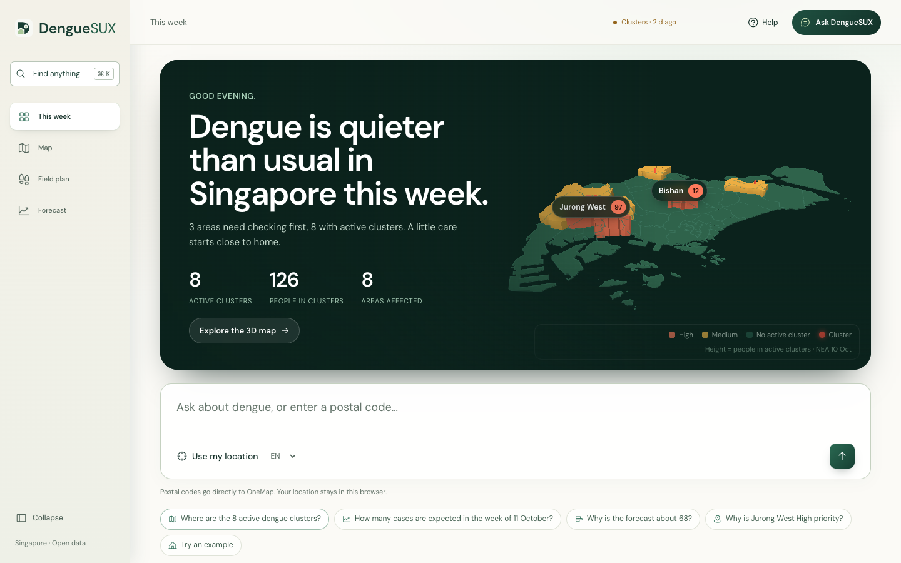

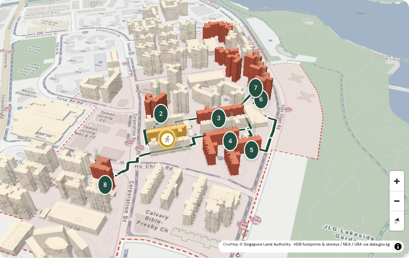

**Where should we look for mosquitoes this week?** DengueSUX turns Singapore's open data into a weekly dengue plan: which areas to check first, which blocks to walk, and what to tell residents, backed by a live national forecast with ranges and a retrospective check through 2026.

Built for the Databricks AI Social Impact (DAISI) Challenge Singapore 2026 · Problem statement **A2 — DengueRadar: Real-time outbreak forecasting**.

> Built by someone who's had dengue three times. The third time nearly killed me.

## Screenshots

Captured from the running app on 12 Oct 2026 with the local saved-data fallback (the answer cards read "Local, no AI"); the hosted-model path words answers differently.

| Home: this week, with the 3D Singapore card | National forecast with 80% range |
|---|---|
|  | 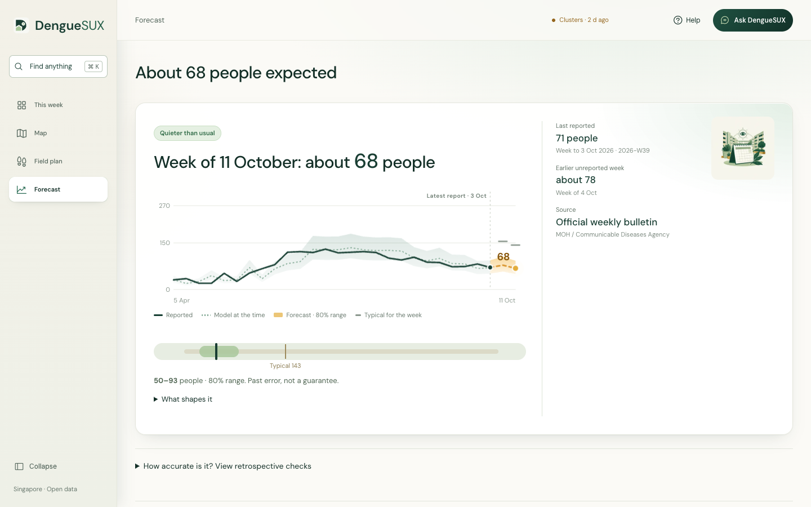 |
| **2D map of 55 planning areas** | **3D map: height = people in active clusters** |
| 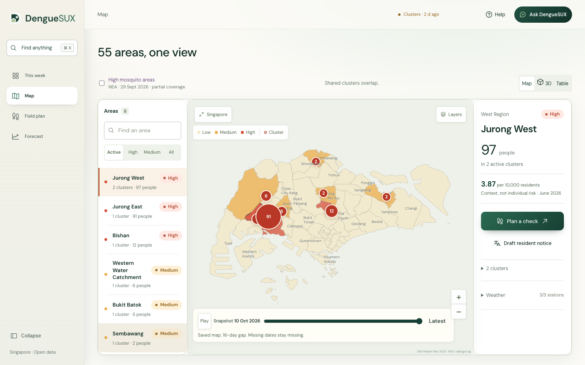 | 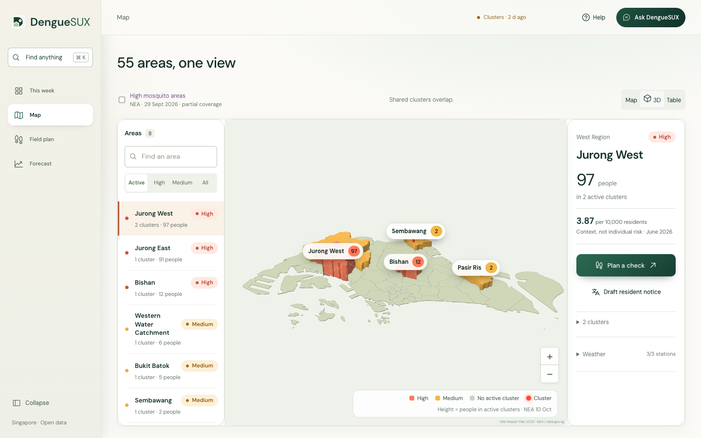 |
| **Field plan with 3D walk preview** | **Area table** |
| 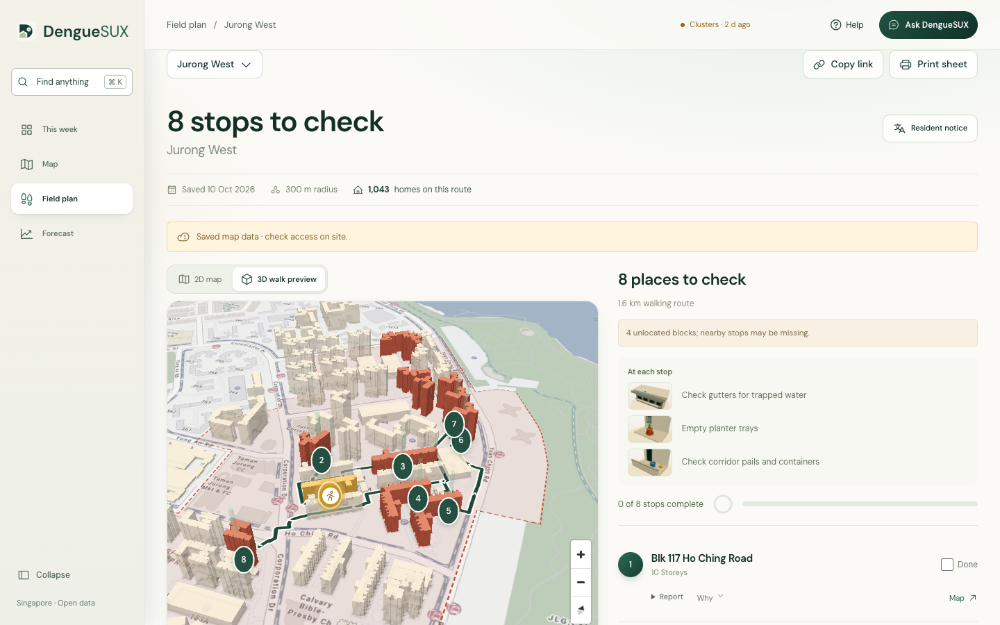 | 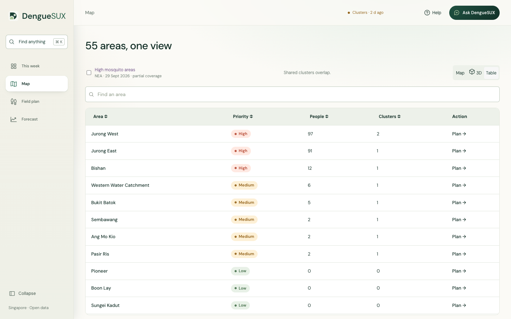 |

### Ask DengueSUX: answers with their visuals

| Where are the clusters? | Why is the forecast about 68? |
|---|---|
| 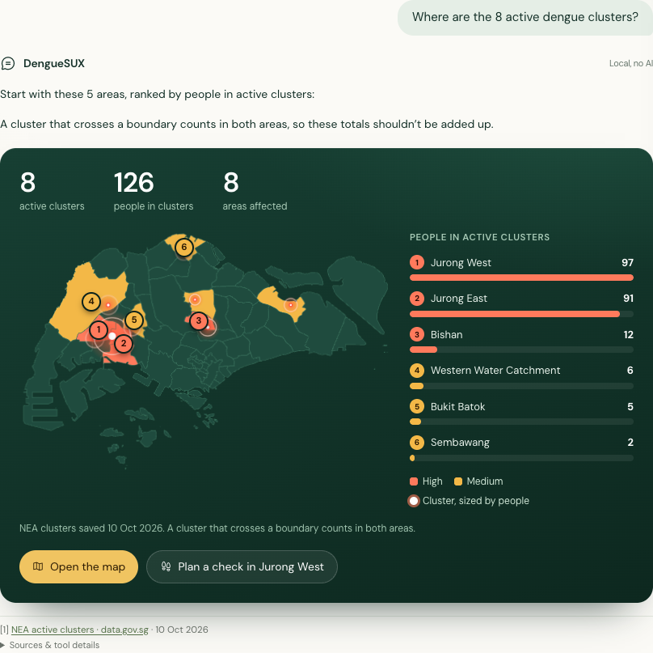 | 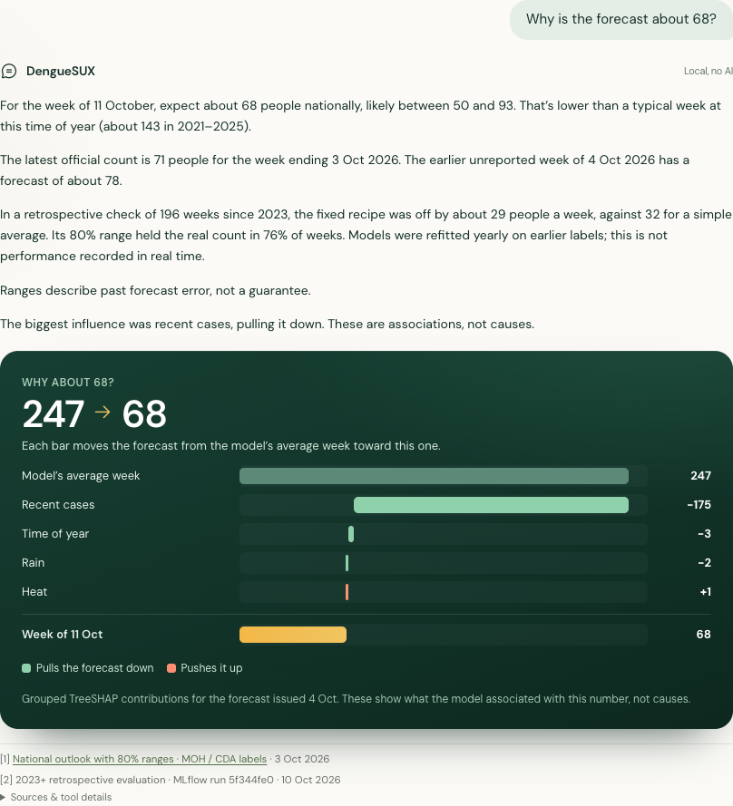 |
| **Plan a check walk** | **How many cases are expected?** |
| 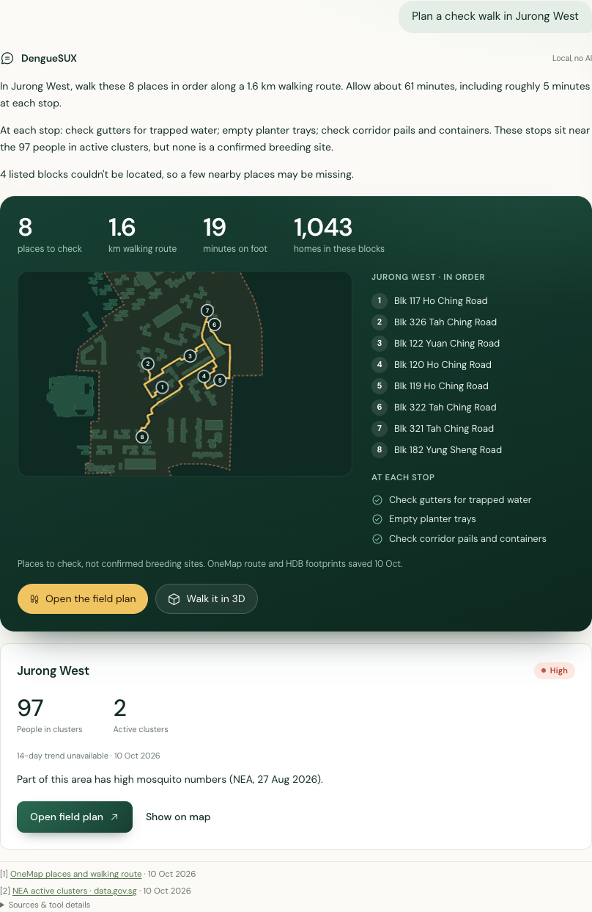 | 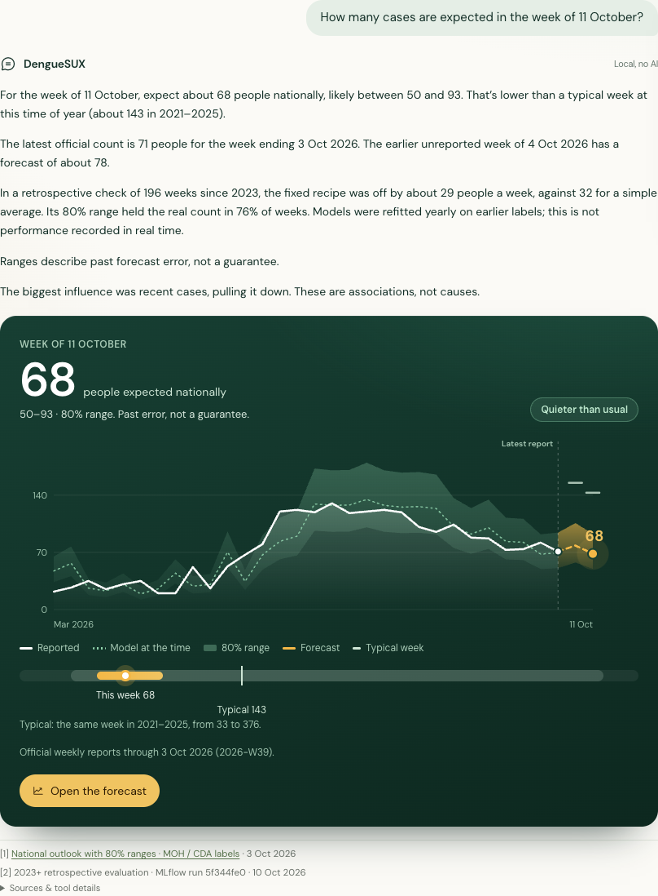 |

## What it does

- **Where to check first:** all 55 URA planning areas ranked by people in active NEA dengue clusters.
- **Inspection plan:** one click turns an area into ranked places to check (cluster HDB blocks, parks, hawker centres) on a OneMap walking route, with a checklist per stop. *Places to check, not confirmed breeding sites.*
- **A 3D walk for every area:** all 55 planning areas open in 3D. Cluster plans keep their scored stops; every other area gets a routine walk through official places (HDB blocks, hawker centres, parks) on a OneMap walking route, and the six areas with no verified place to walk get a flyover. Each stop pauses with a **3D illustration of what to look for** (gutters, planter trays, corridor pails, drains, containers, bin areas, pond edges, tree holes) and highlights where on the block. See `docs/PLATFORM_AUDIT.md` (11 October).
- **3D Singapore:** the home page and the Map's 3D view raise every planning area by people in active clusters.
- **3D walk preview:** the route in 3D with every official HDB block within about 160 m, not just the stops. **Walk the route** follows the whole OneMap path at a steady pace from a low follow camera, pausing at each stop with its checklist; a slider lets you drag along the route. Shapes are HDB's published footprints; heights are estimates from published storeys (2.8 m a floor + 1.3 m roof, the NUS Urban Analytics Lab HDB 3D convention). Blocks without a verified storey count stay flat, and non-HDB buildings are not modelled.
- **Check a place privately:** enter a postal code in the conversational home, use the browser’s location, or try a public example. OneMap lookup and distances run in the browser; neither postal codes nor exact coordinates go to DengueSUX or its model. Four dated statuses include NEA’s high-mosquito areas. Remembered places stay on this device, with Forget controls.
- **Resident notices:** English, 中文, Bahasa Melayu and தமிழ் drafts with NEA's Mozzie Wipeout steps; each passes 5 automatic fact checks. Drafts are for human review before sending.
- **Live national outlook:** official MOH/CDA reports through EW39 2026 (week ending 3 October). For the week of 11 October: about **68 people**, with an **80% range of 50–93**. Across 196 evaluated weeks from 2023 onward, error is **28.7 people/week vs 31.9** for a four-week average (**10% lower**); range coverage is **76%**. The 2022 replay remains available as a separate, reused evaluation year.
- **Explanations and sources:** grouped drivers (recent cases, time of year, rain, heat) and a dated source on every number.
- **Ask DengueSUX:** plain-English questions and the SQL behind them. The Databricks app uses a hosted model and a live Genie space; local/offline use has an explicitly labelled saved-data fallback.

See [the conversational-home build report](docs/THIS_WEEK_CHAT_BUILD.md) for local verification, privacy checks, feed filters and pending cloud validation.

## Quick start

Requires **Python 3.12+**. The repository ships the real pipeline outputs in `output/web/`, so you can open the app without downloading data or retraining.

```bash
git clone https://github.com/theApolloAlien/DengueSUX.git
cd DengueSUX
python3 -m venv .venv-prototype
.venv-prototype/bin/pip install -r requirements-app.txt
.venv-prototype/bin/python -m uvicorn app:app --host 127.0.0.1 --port 8787
```

Open http://127.0.0.1:8787. On Windows, use `.venv-prototype\Scripts\python` instead of `.venv-prototype/bin/python`.

**Optional: OneMap credentials.** The saved inspection routes work without them. To refresh geocodes and walking routes, copy the template and fill it in (never commit `.env`):

```bash
cp .env.example .env
# then set ONEMAP_EMAIL and ONEMAP_PASSWORD (free account at onemap.gov.sg)
```

**Full pipeline** (downloads several GB of open data, needs Java 17 or 21 for PySpark/Delta): install everything with `pip install -r requirements.txt` and follow [Install and reproduce](#install-and-reproduce) below. Run the tests with `.venv-prototype/bin/python -m pytest -q tests`.

## Data and credits

Open data from **data.gov.sg** (MOH Weekly Infectious Disease Bulletin; NEA weather archives, real-time weather APIs, dengue clusters and hawker centres; URA Master Plan 2025 planning areas; HDB Property Information and HDB Existing Building footprints; NParks parks), SLA OneMap search, tiles and walking routes, plus official **MOH/CDA weekly workbooks**, **SingStat resident totals**, and **OneMap** (Singapore Land Authority) for geocoding, walking routes and base map tiles. Prevention guidance adapted from NEA's Mozzie Wipeout. Details, checksums and limitations: [DATA_REPORT.md](DATA_REPORT.md) and [MODEL_REPORT.md](MODEL_REPORT.md).

**Limitations:** historical evaluation assumes immediate weekly publication and uses revised official counts. The 80% range is empirical past forecast error, not a guarantee. Area rankings are places to check, not local case predictions or confirmed breeding sites. Weather explanations are associations, not causes. Source observations and stored tables preserve missing values; training-only median imputation and missing-value indicators remain inside the locked estimator. See `MODEL_REPORT.md` for missing-weather rates by evaluation period.

---

## Full documentation

A working, real-data dengue research dashboard for the DAISI Challenge. Explore Singapore's 55 planning areas, current NEA cluster signals, local weather, and a national two-week forecast with baseline comparisons and grouped explanations.

**The app pairs a dated cluster map with a current national outlook.** The data.gov.sg series through 2022 is continued with official MOH/CDA annual workbooks through EW39 2026. Recent labels must pass a freshness gate before a live forecast is exposed. Area priorities help residents decide where to check first; they are a heuristic, not validated local predictions. No synthetic observations or outcomes are used.

DengueSUX builds on existing NEA and university dengue forecasting research; the contribution here is a public-data, explainable workflow that makes provenance, missingness, model selection and fallback state visible to community operators.

### Open the prototype

```bash
.venv-prototype/bin/python -m uvicorn app:app --host 127.0.0.1 --port 8787
```

Open http://127.0.0.1:8787. The delivered `output/web/dashboard.json` contains real pipeline results, so opening the app does not require retraining. Start with the weekly briefing, use Where / Why / What to do, search an area or show the Top 5, and check the NEA Mozzie Wipeout steps. Forecast lab shows the current range, a 2023+ retrospective evaluation, and a separate 52-week 2022 replay. “How to read this” holds dates, assumptions and sources. Export data downloads the underlying evidence.

The national map, fonts, icons and scripts are local assets. The optional 3D walk preview uses pinned MapLibre GL 5.6.1 and official HDB footprints for the stops, cluster blocks and every HDB block within about 160 m of the route; heights are labelled estimates (published storeys × 2.8 m + 1.3 m roof). Reduced-motion users step through stops manually or with the arrow keys. Map geometry comes from URA's actual GeoJSON. The street-level inspection map loads attributed OneMap tiles, so its base map needs network access; saved cluster and inspection geometry remains dated and inspectable. The web UI uses vanilla JavaScript and Leaflet; the local server uses Python/FastAPI. No Node build step is needed. OneMap credentials are needed when public search is unavailable and for automatic renewal/routing; the original dashboard and local notice templates do not require them.

### Install and reproduce

Use **Python 3.12 and Java 17 or 21**. Tested locally with Python 3.12, Java 21, PySpark 4.0.1 and Delta 4.0.0.

```bash
uv venv --python 3.12 .venv-prototype
uv pip install --python .venv-prototype/bin/python -r requirements.txt
# Existing Phase 1 archives and Phase 2 station-day extracts are already saved locally.
.venv-prototype/bin/python scripts/run_pipeline.py
.venv-prototype/bin/python scripts/export_html.py
.venv-prototype/bin/python -m pytest -q tests
.venv-prototype/bin/python scripts/verify_pipeline.py
```

Spark automatically resolves local Delta jars from Maven on the first run. The runner sets worker Python to the active virtual environment. Raw data and local generated storage are ignored by git; if copying only source files to a new machine, reproduce the real inputs first:

```bash
.venv-prototype/bin/python scripts/collect_dengue.py
.venv-prototype/bin/python scripts/phase1_rainfall.py
.venv-prototype/bin/python scripts/phase1_weather.py
.venv-prototype/bin/python scripts/prepare_weather.py
.venv-prototype/bin/python scripts/snapshot_clusters.py
```

These full collectors transfer several GB before compression. Completed, checksum-verified archives are reused. `prepare_weather.py` scans all 125,148,250 real observations across the 2017–2022 rainfall, temperature and humidity archives using bounded-memory DuckDB. It produces 195,800 station-days in a roughly 2 MB compressed input for Spark. DuckDB is a local preparation/audit tool; all medallion weekly joins, features and Delta tables are PySpark. Complete original archives and source receipts remain the immutable bronze files; the compact extracts are explicitly derived inputs, not raw minute-level observations.

### Pipeline and artifacts

| Stage | Notebook source | What it produces |
|---|---|---|
| Setup | `notebooks/00_setup.py` | Python dependencies and configuration instructions |
| Bronze | `notebooks/01_bronze.py` | Delta bulletin rows, exact GeoJSON source envelopes, archive receipts, and full station-day extracts |
| Silver | `notebooks/02_silver.py` | Clean station-days, national weekly cases/weather, 55-area weekly weather panel with unavailable local outcomes left null |
| Gold | `notebooks/03_gold.py` | 1–8 week weather/case lags, national predictions, MLflow run, current area priorities, inspection candidates/routes, cluster comparisons, notices and application JSON |
| View | `notebooks/04_dashboard.py` | Standalone dashboard with Databricks `displayHTML` |
| Daily refresh | `notebooks/05_daily_inspection.py` | One immutable current snapshot, growth comparison, inspection plan and resident drafts; does not retrain the historical model |

Notebook stages call the shared implementation in `denguesux/pipeline.py`; keep the `denguesux/` package alongside the notebooks. Run one stage locally with `scripts/run_pipeline.py --stage bronze|silver|gold`.

- `DATA_REPORT.md`: original full Phase 1 feasibility evidence.
- `MODEL_REPORT.md`: generated, measured model/baseline metrics and assumptions.
- `data/phase2_inputs/weather_manifest.json`: full historical weather provenance, coverage and quality audit.
- `data/delta/`: locally persisted bronze/silver/gold Delta tables.
- `output/web/`: real JSON used by the UI.
- `output/denguesux.html`: self-contained app export, generated with `scripts/export_html.py`.
- `output/verification.json`: independent checks against persisted results.
- `design-qa.md`: browser verification and screenshots.
- `app/web/vendor/`: locally vendored Leaflet, Phosphor icons and DM Sans, with license notices.

### Forecast meaning and evaluation

The target is **the national case count in week t+2**, a single Sunday–Saturday week. It is not a two-week cumulative count. Inputs end at week t; issuance is assumed on the Sunday after that week. Actual bulletin publication delays/revisions are unknown, so results are a retrospective feasibility study.

Model selection uses **39 expanding four-week folds across 2019–2021**, including outbreak years. Each fold sees only target labels available before its issue date. Three fixed candidates compete: the four-week average, a Ridge residual model and gradient boosting. The lowest equal-year mean absolute error wins; exact ties prefer baseline, then Ridge, then boosting. Selection is locked before refitting and evaluating only the winner and baseline on 2022. **2022 was already viewed during earlier revisions**, so this is a reused evaluation year, not newly unseen data.

**Gradient boosting won.** Its 2022 average absolute weekly error is **83.2 people**, against **172.4** for the simple average (51.7% lower). National band accuracy is **94.2%**, against **92.3%**. The first High forecast was issued **11 weeks before** the observed peak, versus **10 weeks** for the average. High is a training-derived statistical band, not an official outbreak alert; crossing it early does not predict the peak date. This is one retrospective year with assumed report availability. See `MODEL_REPORT.md` for annual validation errors and the exact protocol.

The fixed recipe is refitted annually for the **2023+ retrospective evaluation**, using only earlier labels at each refit. It is not a record of forecasts actually issued since 2023. The final weather comparison gives **28.7** people/week error with weather versus **28.5** without weather; weather did not improve this later evaluation. The feature comparison is diagnostic and does not alter the locked selection. Live forecasts are computed separately, with each row’s training cutoff exported.

Learned candidates predict a change from the most recent national count using eight weeks of weather/case history, trend and time of year. Weather imputation is fitted on training data only; missing indicators remain associated with their metric. The baseline predicts the latest four-week mean. No local accuracy is claimed because historical planning-area outcomes are unavailable.

MLflow logs the **complete selected predictor**, including the most recent count and nonnegative floor, plus validation/evaluation results and configuration. The exported model's `predict()` directly returns national people, with no caller-side adjustment. Predictions, names, risk bands and explanations always refer to that same selected model. Four grouped explanations are Recent cases, Time of year, Rain and Heat (temperature and humidity). Gradient boosting uses additive TreeSHAP; correlated inputs mean these are associations, not causal claims. A logging failure stops the run.

Weekly label adapters are available in `scripts/weekly_labels.py`. They accept a data.gov.sg CSV/JSON export or an approved NEA/MOH manifest, preserve publication/retrieval timestamps, source URLs and checksums, validate Sunday–Saturday weeks and duplicate/missing labels, and expose a freshness gate. Adapters prepare future ingestion; they do not automatically connect a new source to live forecasting. Run `.../python scripts/weekly_labels.py <manifest.json>` to inspect a source before making it eligible for a current forecast.

```bash
.venv-prototype/bin/mlflow ui --backend-store-uri sqlite:///output/mlflow.db --port 5001
```

### Geography, weather and local assumptions

The map preserves separate source-update, retrieval and weather dates. `CASE_SIZE` is the total associated with an active cluster, not new infections this week; repeated snapshots must never be summed into incidence. National predictions are not allocated to areas.

Every positive-area intersection associates a cluster with that planning area; a boundary touch alone does not. The 74-person cluster intersects both Jurong West and Jurong East. Jurong East has 76 people across two clusters, Jurong West 74 across one. Area totals overlap (175 associations); the national total stays **101 people in 11 unique clusters**.

Areas rank by people in active clusters, then cluster count, then observed local weather. Construction metadata is retained but never scored. Missing weather contributes zero and reduces completeness; no assumed temperature is inserted. Heuristic bands are **High: 10+ people in active clusters; Medium: other active clusters; Low: no active cluster in this snapshot**. Public screens show those words, not internal index points. These are not disease probabilities, incidence rates or an assurance of safety. The map opens on all of Singapore; circles grow with cluster size.

The action card follows NEA's official [B-L-O-C-K checklist](https://www.nea.gov.sg/dengue-zika/stop-dengue-now), recommended at least weekly. The life-cycle timeline illustrates an opportunity to act, not a proven two-week causal chain. Under optimal conditions Aedes can develop in about a week; acquiring/transmitting dengue and developing symptoms require additional variable intervals.

Current local weather uses the nearest station to an area's representative point within 15 km, with ≥90% of nominal daily readings. Missing observations are shown as unavailable; they add no weather points and reduce completeness. Historical area weather uses stations physically inside the fixed 2025 polygons; areas without stations remain missing. Historical national weather averages usable station-days, then requires all seven dates for a weekly value. Rain is summed over time within stations and averaged across stations, never summed across stations. Network composition changes over time.

The weather audit excludes invalid/sentinel values and conflicting duplicates. It found 70,380 humidity observations above 100% and 126 conflicting duplicate keys. Out of 2,191 calendar days, usable national days are rainfall 2,050, temperature 2,091, humidity 2,070. There are 269 weeks with complete weather across all three metrics before alignment with case history. Missing rain is never changed to zero.

### Inspection plans: places to check

Select an area, then **Plan inspection**. The street-level view shows the actual NEA footprint, a ring around each exactly geocoded cluster block, numbered stops, a route and a three-item checklist per place type. Stops support source reduction, not fogging. A point marks a place worth checking, never a known breeding location. Every score component and plain-language reason is stored with the place's dated sources. Google Maps links use coordinates only; no Google API key or Street View embed is used. Print produces a compact officer/volunteer route sheet.

**Verified delivery, 24 September 2026:** authenticated OneMap requests produced **22 verified cluster blocks from 26 parsed addresses**. Jurong West and Jurong East each show an eight-stop OneMap walking route around the shared 74-case cluster, using ten verified cluster blocks and eleven nearby candidates. Three independent authenticated OneMap spot checks passed. Four unresolved addresses remain absent; coverage is explicitly partial. Earlier HTTP-200 responses carrying authentication errors were rejected and are never reused as successful geocodes. `output/verification/inspection.json` records the passing Jurong acceptance and traceability checks on all 36 displayed stops.

`DATA_REPORT.md` records the data check performed before building, including locality parse success, dataset IDs, timestamps, raw and stored SHA-256 checksums and row counts. Candidate inputs are the HDB Property Information block list, NParks Parks point layer and NEA Hawker Centres points. Park connector lines, NParks management polygons and URA land-use/waterbody polygons do not establish a verified walkable stop or entrance and are dropped from route points. The historical HDB elderly table lacks a valid all-age denominator and planning-area join; elderly share is unavailable and adds no points. Nothing is substituted with synthetic data.

The default **300 m radius and eight stops are planning assumptions**. Candidates are restricted to genuine source points inside a ring around a verified block. HDB geocoding is bounded to reported cluster streets and an additional-query budget; it is a partial shortlist, not a complete survey of all premises. OneMap walking directions are used when available. Otherwise, nearest-neighbour ordering and a straight connector line are labelled **approximate order**, with no invented walking time or claim of pedestrian access.

The capped 100-point rule is:

| Component | Contribution | Limit |
|---|---|---|
| Place type | Block 25; hawker centre 20; park 15 | 25 |
| Proximity | `35 × max(0, 1 − distance_m / radius_m)` | 35 |
| Cluster size | `20 × min(reported_cases, 100) / 100` | 20 |
| Seven-day cluster change | `10 × min(max(change, 0), 20) / 20` | 10 |
| Elderly share | `10 × min(share_aged_65_plus / 0.30, 1)` | 10 |

Missing growth or elderly share stays null and adds zero priority points; weights are not redistributed. Use the nearest verified cluster block, breaking equal-distance ties by larger reported cluster size and then source ID. This rule is not a disease forecast or validated finding probability. The required footnote is: **“Places to check, ranked by nearby cases and place type. Not confirmed breeding sites.”**

### OneMap setup and renewal

The safe `.env.example` contains blank configuration fields. The ignored local `.env` holds the supplied token privately; email and password remain blank for you to fill:

```dotenv
ONEMAP_TOKEN=
ONEMAP_EMAIL=
ONEMAP_PASSWORD=
```

A pasted token is optional when email and password are supplied. The server reads these values from `.env` or process environment, never from browser JavaScript. Before a OneMap operation it reuses a token with at least 12 hours remaining, or renews through the documented OneMap auth endpoint. It reads actual expiry instead of assuming a new three-day lifetime for a pasted token. `data/private/onemap_token.json` stores the token and expiry with restrictive permissions; `.env`, private caches and generated data are excluded from version control and the Databricks bundle. Tokens, credentials, auth headers and API exception bodies are not logged or exported.

Renewal is automatic when the pipeline runs, not a hidden background service. If renewal fails, requests become cached-only and the page shows **“Map data may be stale.”** Verified geocodes and their retrieval times are preserved in `data/cache/onemap/geocodes.json`; missing coordinates remain missing. A public-search attempt is permitted only when no credentials were supplied. An HTTP 200 response carrying an authentication error is not usable evidence.

```bash
# Collect the seven audited place/elderly layers; verified cached files make no network requests.
.venv-prototype/bin/python scripts/collect_inspection_sources.py
# Refresh the inspection plan from the existing current cluster snapshot.
.venv-prototype/bin/python scripts/build_inspection.py --radius-m 300 --top-n 8 --delta
# Recheck saved block geocodes after filling credentials.
.venv-prototype/bin/python scripts/build_inspection.py --refresh-geocodes --delta
# Reproduce only from genuine saved caches; displays the stale-data warning.
.venv-prototype/bin/python scripts/build_inspection.py --offline
.venv-prototype/bin/python scripts/verify_inspection.py
```

The inspection stage publishes `bronze_inspection_sources`, `silver_inspection_cluster_blocks`, `silver_inspection_places`, `inspection_candidates` and `inspection_routes`. Small geographic joins run in shared Python/Shapely code; persistence uses explicit-schema PySpark/Delta, locally or in Databricks. JSON mirrors live in `output/gold/` and `output/web/inspection.json`.

### Walks for every area

```bash
# Needs a OneMap token (email/password in .env renew it); verified answers are cached in data/cache/onemap/.
.venv-prototype/bin/python scripts/build_walks.py
.venv-prototype/bin/python scripts/build_walks.py --areas TP AM
```

Writes `output/web/walks/<CODE>.json` (plan, official HDB footprints around the route, URA Master Plan parks and water) and `index.json`. The order rule is place type (block 25, hawker centre 20, park 15) + compactness (35 × (1 − distance to the walk centre / 350 m)) + homes (40 × min(HDB homes within 150 m / 1,500, 1)); no case counts. Block pins sit inside the block's own HDB footprint. Walks are static artifacts: the daily job does not rebuild them, because OneMap refuses the Databricks network. `demo/verify_walks.py` opens all 55 areas in headless Chromium.

### 3D walk preview: how the buildings are built

The 3D view shows only official geometry. **Footprints** are HDB Existing Building polygons from data.gov.sg (`d_16b157c52ed637edd6ba1232e026258d`), rounded to 7 decimal places (about 1 cm). Invalid source polygons are skipped, never repaired; points are never turned into boxes.

**Heights** need a join from a footprint to HDB Property Information's `max_floor_lvl`. Footprints carry an HDB street code (`ST_COD`, e.g. `TOG02Q`), while the property table uses street names. `scripts/collect_map_context.py --street-codes` resolves each code once through OneMap's public search (no credentials): a real footprint postal code must come back with the same postal code and block number, and HDB Property Information must list that block on the returned road. Whole-word HDB abbreviations (LOR/LORONG, PK/PARK, C WEALTH/COMMONWEALTH, …) are accepted only when exactly one road matches. 625 of 660 codes verified (12,692+ footprints); unresolved codes keep their blocks flat. The mapping and its response hashes are saved in `data/raw/inspection/hdb_street_codes.json` and uploaded to the Volume for the daily job.

Height = published storeys × 2.8 m + 1.3 m roof allowance, following the NUS Urban Analytics Lab HDB 3D model (Biljecki 2020). There is no public LiDAR for Singapore, so this is an estimate, labelled as such in the view and in “How to read this”. Stops, cluster blocks and nearby blocks are coloured differently; nearby blocks are see-through so they never hide a stop. Tap a block to see its storeys, estimated height, uses and source. Condos, schools and other non-HDB buildings remain flat on the OneMap base map. **Walk the route** starts from the whole-route view, descends to a follow camera 80 m up and 90 m behind the walker, keeps one heading per leg (turning only around stops, at most 24°/s; it rises higher among tall towers), pauses at each stop with its checklist, colours the walked part of the track and ends on the whole route; reduced motion keeps the slider and still stop views only. An audit against OpenStreetMap found the published storey count on 109 of 113 independently tagged blocks, and HDB outlines aligned with SLA's base map where OSM was offset (see `docs/PLATFORM_AUDIT.md`). Placement was cross-checked against satellite imagery for the Jurong West, Bukit Batok and Bishan routes (see `docs/PLATFORM_AUDIT.md`).

### Daily cluster history and growth

```bash
.venv-prototype/bin/python scripts/snapshot_clusters.py
```

This saves original source bytes, hashes and retrieval time under `data/snapshots/clusters/YYYY-MM-DD/`. Re-running on the same Singapore date reuses the immutable snapshot. The genuine snapshots currently span **24 September to 10 October 2026**. The 16-day comparison and playback are labelled with their actual dates; the stricter 7–9-day growth measure still says **“Not enough history yet.”** There is no backfill or invented seven-day history. A checksum mismatch fails closed.

Once a full seven-day span exists, the tracker chooses the nearest saved snapshot **7–9 days earlier**, allowing at most two missing daily runs. Both at least 10% overlap of the smaller polygon and at least 25% Jaccard similarity of locality words are required. Source `OBJECTID` equality alone is not a match. Unique matches are Growing, Stable or Shrinking according to their cumulative reported cluster-count change. Unmatched current clusters are New; absent prior clusters are Closed, meaning no longer in the current feed, not certified absence of transmission. Ambiguous splits/merges are labelled incomparable and contribute no growth points. These differences are not weekly incident infections.

```bash
# Collect today's immutable snapshot, refresh all fieldwork outputs and Delta tables.
.venv-prototype/bin/python scripts/daily_inspection.py --delta --radius 300 --top 8
# Rebuild outputs using only saved evidence; useful offline.
.venv-prototype/bin/python scripts/daily_inspection.py --offline
.venv-prototype/bin/python scripts/export_html.py
```

The daily runner updates `current.json`, `growth.json`, `inspection.json`, `notices.json` and the combined dashboard. Existing actual weather dates are retained; a new cluster download never pretends the weather was refreshed. It writes `gold_cluster_growth` and `gold_resident_notices` when Spark is supplied, and `output/daily_inspection_status.json` records the last run. The large historical backfill and model training are not daily tasks.

`databricks.yml` defines Free Edition **serverless-only** jobs. The daily schedule is **08:15 Asia/Singapore, UNPAUSED**. It lands official API responses in the Unity Catalog Volume, ingests new files with Auto Loader `availableNow`, then refreshes cluster/inspection outputs. Persistent checkpoints avoid reprocessing saved files. Heavy archive reduction stays local. Always pass `--profile denguesux` to Databricks CLI commands. The app refreshes its approved public dashboard from the Volume at most once a minute and retains dated saved data if refresh fails. The OneMap token remains local and is never uploaded. See [governance and ingestion](docs/GOVERNANCE_INGESTION.md) for table tags, lineage evidence and the Python lineage boundary.

The app also provides “What changed”, saved-date cluster playback, Check my block, homes per route, and unverified field reports stored in a restricted Unity Catalog table. A report must name a stop in the current saved plan; its optional note is stored but never returned by the app's API or included in exports. Report-storage verification uses a zero-row insert and never creates a pretend observation. Alerts are written to `alerts.json`/`gold_alerts` on every run but sent to a webhook or Telegram only by the scheduled daily job, and only when a destination is configured.

### Resident notice drafts

For each selected area, the app offers English, Chinese, Malay and Tamil notices, copy and text-download actions, and the label **“Draft: review before sending.”** The saved export contains 55 × 4 drafts. Each stays within approximately 80 words (Chinese uses a 350-character limit), identifies the planning area and dated cluster snapshot, and includes NEA's five Mozzie Wipeout actions. Sources and the exact gold facts are shown under the notice. A zero-cluster area says no active cluster was reported in that snapshot; it does not assert zero dengue risk. Place names are kept as published English labels and every translation needs human review.

Local mode is explicitly **“Local template fallback · no LLM used.”** `denguesux/notices.py` exposes a `NoticeProvider` interface. In a Databricks runtime, a server request uses `DATABRICKS_NOTICE_ENDPOINT` and workspace SDK unified authentication (or server-only `DATABRICKS_HOST` / `DATABRICKS_TOKEN` when configured) to call the Foundation Model chat API. Static/batch exports stay deterministic and do not issue 220 paid calls. No credentials are returned to the UI.

The fixed `gold-only-notice-v1` prompt supplies only the approved dated gold facts and credited prevention sentences. The model may arrange the approved sentences; an exact allowlist rejects changed numbers, extra facts, omitted advice or new claims. Failed or unconfigured calls use the labelled local template with a clear fallback note. This conservative interface sacrifices free-form generation to preserve factual constraints. `/api/notices/{area_code}?language=en|zh|ms|ta` returns a draft, never sends it. Source guidance: [NEA prevention / BLOCK page](https://www.nea.gov.sg/dengue-zika/prevent-aedes-mosquito-breeding) and [NEA home prevention checklist](https://www.nea.gov.sg/dengue-zika/prevent-aedes-mosquito-breeding/other-preventive-measures), checked 24 September 2026.

No photo-report stretch feature was added. The app requests no names, phone numbers, email addresses or resident images. Optional field-report notes are treated as potentially private and are excluded from public exports. OneMap account credentials are private operational configuration, not public resident data.

### Port to Databricks Free Edition / serverless

1. Put the source repository in a Databricks Git folder/workspace. Import the `.py` files in `notebooks/` as Python notebooks; they use `# Databricks notebook source` and command separators. Add the repository root to Python's path if the notebook folder is the working directory.
2. Upload `data/raw/dengue/`, `data/raw/boundaries/`, the saved `data/raw/weather/` sample pages, `data/phase2_inputs/`, and `data/snapshots/` to a Unity Catalog Volume, keeping paths beneath a `denguesux/` root. The small station-day input is sufficient for training; upload full annual raw archives when storage permits. Keep receipts and manifests for traceability.
3. Run the Python-only dependencies in `00_setup.py`. **Do not pip-install PySpark or delta-spark in Databricks**; use its existing Spark session and Delta runtime. sklearn runs only on the compact national weekly matrix; no unsupported Spark MLlib or RDD APIs are needed.
4. Set the following before importing the package in **each** notebook (replace placeholders):
   ```python
   import os, sys
   sys.path.insert(0, '/Workspace/Repos/<user>/<repository>')
   os.environ['DENGUE_ROOT'] = '/Volumes/<catalog>/<schema>/<volume>/denguesux'
   os.environ['DENGUE_TABLE_PREFIX'] = '<catalog>.<schema>'
   os.environ['DENGUE_MLFLOW_EXPERIMENT'] = '/Users/<email>/DengueSUX'
   ```
   In Databricks, `DENGUE_TABLE_PREFIX` is required: Delta outputs are Unity Catalog **managed tables**, not Delta directories in Volumes. Local execution defaults to path-based Delta. Use a writable catalog/schema and create your experiment as needed. MLflow uses the workspace tracking service unless explicitly overridden.
5. Run bronze → silver → gold. Existing serverless `spark` is passed to the shared stages; no local Spark master or JVM configuration is set. The implementation uses PySpark DataFrame/SQL APIs compatible with Spark Connect. All year/minute reduction has been performed locally to stay within Free Edition resource limits.
6. Generate `output/denguesux.html` locally, upload it to the Volume and run `04_dashboard.py`. After refreshing data on Databricks, regenerate the bundle from the exported JSON with the included asset exporter. The Python/FastAPI development server is for local preview; Databricks notebooks render the static bundle through `displayHTML`.

Local execution and Databricks Free Edition serverless execution have both been verified. App deployment and job-run evidence for this finishing run are recorded in [build progress](docs/BUILD_PROGRESS.md). OneMap and optional workspace-model credentials are configured privately as described above; none are supplied in the source.
